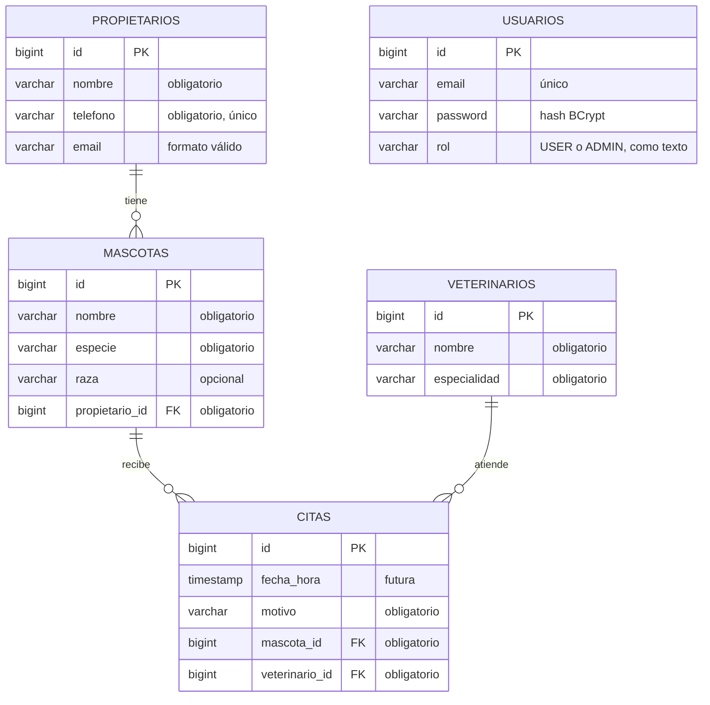

# VetTurno

**La agenda digital de Veterinaria Huellitas.**
API REST construida con Spring Boot para registrar responsables, mascotas y veterinarios, y agendar citas sin cruces de horario, con seguridad JWT por roles.

> Taller evaluativo · Java AI Engineer · Módulo 3 — Backend profesional con Spring Boot

---

## Tabla de contenido

1. [La historia](#1-la-historia)
2. [Alcance del MVP](#2-alcance-del-mvp)
3. [Tecnologías](#3-tecnologías)
4. [Arquitectura](#4-arquitectura)
5. [Modelo de datos](#5-modelo-de-datos)
6. [Roles y permisos](#6-roles-y-permisos)
7. [Endpoints](#7-endpoints)
8. [Configuración y ejecución](#8-configuración-y-ejecución)
9. [Flujo de prueba recomendado](#9-flujo-de-prueba-recomendado)
10. [Formato de errores](#10-formato-de-errores)
11. [Matriz de pruebas manuales](#11-matriz-de-pruebas-manuales)
12. [Decisiones de diseño](#12-decisiones-de-diseño)
13. [Errores frecuentes](#13-errores-frecuentes)
14. [Uso de IA](#14-uso-de-ia)
15. [Mejoras futuras](#15-mejoras-futuras)

---

## 1. La historia

Doña Marta abrió **Veterinaria Huellitas** hace seis años. Atiende la clínica junto con el doctor Andrés y con Paula, quien recibe llamadas, responde mensajes y organiza las citas.

La agenda vivía entre un cuaderno y conversaciones de WhatsApp. En los días ocupados, Paula podía reservar dos consultas para el mismo veterinario a la misma hora, escribir mal el nombre de una mascota o perder el teléfono de su responsable. El problema no era falta de cuidado, sino que la información estaba dispersa.

**VetTurno** centraliza esa información en una API persistente, validada y segura.

### Personas usuarias

| Persona | Rol en VetTurno | Necesidad |
|---|---|---|
| Paula · Recepcionista | `USER` | Registra responsables y mascotas, agenda citas y consulta la agenda. |
| Doña Marta · Administradora | `ADMIN` | Hace todo lo de recepción y además registra veterinarios. |
| Doctor Andrés · Veterinario | — (no inicia sesión) | Necesita ver sus citas ordenadas y asociadas a la mascota correcta. |

---

## 2. Alcance del MVP

| Incluye | Fuera de alcance |
|---|---|
| Registro y login con roles `USER` y `ADMIN` | Historia clínica, diagnósticos o fórmulas |
| Responsables, mascotas, veterinarios y citas | Pagos, facturación o inventario |
| Prevención de citas duplicadas por veterinario y horario | Recordatorios por correo o WhatsApp |
| Consulta de citas por veterinario | Interfaz web o aplicación móvil |
| Validaciones, manejo global de errores y Swagger | Despliegue en la nube y Docker |

---

## 3. Tecnologías

| Tecnología | Versión | Uso |
|---|---|---|
| Java | 17 | Lenguaje |
| Spring Boot | 4.1.1 | Framework base, servidor Tomcat embebido |
| Maven (wrapper) | 3.10 | Dependencias y construcción |
| Spring Web MVC | — | API REST |
| Spring Data JPA + Hibernate | 7.4 | Persistencia y mapeo objeto-relacional |
| PostgreSQL | 18 | Base de datos |
| Spring Security | 7.1 | Autenticación, autorización y BCrypt |
| JJWT | 0.13.0 | Generación y validación de JWT |
| Bean Validation (Hibernate Validator) | — | Validación de DTO de entrada |
| springdoc-openapi | 3.1.0 | Documentación OpenAPI y Swagger UI |
| Lombok | 1.18 | Reducción de código repetitivo |

---

## 4. Arquitectura

La aplicación sigue una arquitectura por capas. Cada petición recorre siempre el mismo camino:

```
Cliente (Swagger / Postman)
      │  JSON + Authorization: Bearer <token>
      ▼
JwtAuthFilter ──► SecurityConfig (¿autenticado? ¿rol suficiente?)
      ▼
Controller   → traduce la petición HTTP, activa @Valid y elige el estado HTTP
      ▼
Service      → reglas de negocio (existencia de relaciones, fecha futura, cruce de horario)
      ▼
Repository   → acceso a PostgreSQL mediante JpaRepository y consultas derivadas
      ▼
PostgreSQL
```

Los errores que se lanzan en cualquier capa los traduce `GlobalExceptionHandler` a una respuesta `ApiError` con formato estable.

### Estructura de paquetes

```
com.nickbern.vetturno
├── config        OpenApiConfig: identidad de la API y esquema Bearer en Swagger
├── controller    Endpoints REST (Auth, Propietario, Mascota, Veterinario, Cita)
├── dto           Records de entrada (…Request) y salida (…DTO, AuthResponse)
├── exception     ApiError, NegocioException y GlobalExceptionHandler
├── mapper        Conversión de entidad a DTO de salida
├── model         Entidades JPA y enum Rol
├── repository    Interfaces JpaRepository con consultas derivadas
├── security      JwtService, JwtAuthFilter, UsuarioDetailsService, SecurityConfig
├── service       Lógica de negocio
└── VetTurnoApplication.java
```

---

## 5. Modelo de datos



*Diagrama entidad-relación: un propietario tiene muchas mascotas; cada cita une una mascota con un veterinario. `usuarios` no se relaciona con las demás tablas: solo sirve para autenticación.*

### Relaciones

| Relación | Cardinalidad | Lado dueño (llave foránea) | Dirección |
|---|---|---|---|
| Propietario → Mascota | 1 : N | `mascotas.propietario_id` | Unidireccional (`@ManyToOne` en Mascota) |
| Mascota → Cita | 1 : N | `citas.mascota_id` | Unidireccional (`@ManyToOne` en Cita) |
| Veterinario → Cita | 1 : N | `citas.veterinario_id` | Unidireccional (`@ManyToOne` en Cita) |

Todas las relaciones usan `FetchType.LAZY`. Las razones de este diseño están en [Decisiones de diseño](#12-decisiones-de-diseño).

---

## 6. Roles y permisos

| Ruta | Público | `USER` | `ADMIN` |
|---|---|---|---|
| `POST /api/auth/register` y `POST /api/auth/login` | ✅ | ✅ | ✅ |
| Swagger UI y `/v3/api-docs` | ✅ | ✅ | ✅ |
| `GET` y `POST` de propietarios, mascotas y citas | ❌ 401 | ✅ | ✅ |
| `GET /api/veterinarios` | ❌ 401 | ✅ | ✅ |
| `POST /api/veterinarios` | ❌ 401 | ❌ **403** | ✅ |

- **401 Unauthorized:** la petición no trae token, el token es inválido o expiró. El sistema no sabe quién eres.
- **403 Forbidden:** el token es válido, pero el rol no tiene permiso. El sistema sabe quién eres y no te deja.
- El registro **siempre asigna `USER`**. El rol nunca se recibe del cliente.
- La API es **stateless**: el servidor no guarda sesión y cada petición protegida debe enviar `Authorization: Bearer <token>`.
- El token dura **1 hora** (`jwt.expiration-ms`).

### Habilitar el primer ADMIN

Por diseño, ningún endpoint permite crear administradores. El primer ADMIN se habilita de forma controlada en la base de datos:

1. Registrar la cuenta normalmente con `POST /api/auth/register`. Queda como `USER`.
2. Cambiar el rol en PostgreSQL:
   ```sql
   UPDATE usuarios SET rol = 'ADMIN' WHERE email = 'marta@huellitas.com';
   ```
3. Iniciar sesión de nuevo con `POST /api/auth/login` y usar el token nuevo.

---

## 7. Endpoints

La documentación interactiva completa está en **Swagger UI**: `http://localhost:8080/swagger-ui/index.html`.

| Método | Ruta | Acceso | Éxito | Descripción |
|---|---|---|---|---|
| POST | `/api/auth/register` | Público | 200 | Registra un `USER` y devuelve un token |
| POST | `/api/auth/login` | Público | 200 | Verifica credenciales y devuelve un JWT |
| POST | `/api/propietarios` | USER / ADMIN | 201 | Crea un responsable |
| GET | `/api/propietarios` | USER / ADMIN | 200 | Lista responsables |
| POST | `/api/mascotas` | USER / ADMIN | 201 | Crea una mascota asociada a un propietario existente |
| GET | `/api/mascotas` | USER / ADMIN | 200 | Lista mascotas con su propietario resumido |
| POST | `/api/veterinarios` | **ADMIN** | 201 | Crea un veterinario |
| GET | `/api/veterinarios` | USER / ADMIN | 200 | Lista veterinarios |
| POST | `/api/citas` | USER / ADMIN | 201 | Agenda una cita futura y sin cruce de horario |
| GET | `/api/citas` | USER / ADMIN | 200 | Agenda completa |
| GET | `/api/citas/veterinario/{id}` | USER / ADMIN | 200 | Citas de un veterinario, ordenadas por fecha |

### Ejemplos de peticiones y respuestas

**Registro (`POST /api/auth/register`)**
```json
{ "email": "paula@huellitas.com", "password": "recepcion123" }
```
Respuesta `200`:
```json
{ "token": "eyJhbGciOiJIUzI1NiJ9..." }
```
El login (`POST /api/auth/login`) recibe el mismo cuerpo y responde igual.

**Propietario (`POST /api/propietarios`)**
```json
{ "nombre": "Laura Gómez", "telefono": "3001234567", "email": "laura@correo.com" }
```
Respuesta `201`:
```json
{ "id": 1, "nombre": "Laura Gómez", "telefono": "3001234567", "email": "laura@correo.com" }
```

**Mascota (`POST /api/mascotas`)**
```json
{ "nombre": "Toby", "especie": "Perro", "raza": "Beagle", "propietarioId": 1 }
```
Respuesta `201`:
```json
{ "id": 1, "nombre": "Toby", "especie": "Perro", "raza": "Beagle", "propietarioId": 1, "propietarioNombre": "Laura Gómez" }
```

**Veterinario (`POST /api/veterinarios`, solo ADMIN)**
```json
{ "nombre": "Andrés Ruiz", "especialidad": "Medicina general" }
```
Respuesta `201`:
```json
{ "id": 1, "nombre": "Andrés Ruiz", "especialidad": "Medicina general" }
```

**Cita (`POST /api/citas`)**
```json
{ "fechaHora": "2026-11-05T10:30:00", "motivo": "Vacunación anual", "mascotaId": 1, "veterinarioId": 1 }
```
Respuesta `201`:
```json
{ "id": 1, "fechaHora": "2026-11-05T10:30:00", "motivo": "Vacunación anual", "mascota": "Toby", "propietario": "Laura Gómez", "veterinario": "Andrés Ruiz" }
```

> **Formato de fecha:** `fechaHora` se envía en ISO-8601 sin zona horaria, `AAAA-MM-DDTHH:mm:ss`, con la `T` entre fecha y hora y en formato de 24 horas. Formatos como `05/11/2026 10:30` responden 400.

---

## 8. Configuración y ejecución

### Requisitos

- JDK 17
- PostgreSQL en ejecución local (puerto 5432)
- Git
- No hace falta instalar Maven: el proyecto incluye el wrapper (`mvnw`).

### 1. Clonar el repositorio

```bash
git clone https://github.com/DevNico2905/VetTurno.git
cd VetTurno
```

### 2. Crear la base de datos

```sql
CREATE DATABASE vet;
```

La conexión se configura en `src/main/resources/application.properties` (`jdbc:postgresql://localhost:5432/vet`, usuario `postgres`). Hibernate crea y actualiza las tablas al arrancar (`spring.jpa.hibernate.ddl-auto=update`), así que no hay que crear tablas a mano ni cargar datos.

### 3. Definir las variables de entorno

El repositorio **no contiene contraseñas ni secretos**. La aplicación los lee de estas variables:

| Variable | Descripción |
|---|---|
| `DB_PASSWORD` | Contraseña del usuario `postgres` |
| `JWT_SECRET` | Clave HMAC para firmar los JWT, de **al menos 32 bytes** |

Para generar una clave segura:
```bash
openssl rand -base64 64 | tr -d '\n'; echo
```

**macOS / Linux (terminal):**
```bash
export DB_PASSWORD='tu_contraseña'
export JWT_SECRET='la_clave_generada'
```

**Windows (PowerShell):**
```powershell
$env:DB_PASSWORD="tu_contraseña"
$env:JWT_SECRET="la_clave_generada"
```

**IntelliJ IDEA:** *Run → Edit Configurations… → VetTurnoApplication → Modify options → Environment variables*. No marques *Store as project file*, para que los valores no terminen dentro del repositorio.
```
DB_PASSWORD=tu_contraseña;JWT_SECRET=la_clave_generada
```

### 4. Ejecutar

```bash
./mvnw spring-boot:run          # macOS / Linux
.\mvnw.cmd spring-boot:run      # Windows
```

La API queda disponible en `http://localhost:8080` y Swagger en `http://localhost:8080/swagger-ui/index.html`.

### 5. Empaquetar (opcional)

```bash
./mvnw clean package -DskipTests
java -jar target/VetTurno-0.0.1-SNAPSHOT.jar
```

Las pruebas automáticas levantan la aplicación completa, así que necesitan PostgreSQL disponible y las variables de entorno definidas. Por eso se usa `-DskipTests` al empaquetar.

---

## 9. Flujo de prueba recomendado

Este es el orden natural del día en Huellitas. Cada paso depende de datos creados en el anterior.

1. **Registrar a Paula** con `POST /api/auth/register` y copiar el `token`.
2. **Autorizar en Swagger:** botón **Authorize** y pegar el token, sin escribir `Bearer`, porque Swagger lo agrega. En Postman: pestaña *Authorization → Bearer Token*.
3. **Crear un propietario** con `POST /api/propietarios`.
4. **Crear una mascota** con `POST /api/mascotas` y el `propietarioId` del paso 3.
5. **Intentar crear un veterinario como Paula** con `POST /api/veterinarios`. Resultado esperado: **403**.
6. **Habilitar a Doña Marta como ADMIN:** registrarla, ejecutar el `UPDATE` de la sección 6 y hacer login de nuevo.
7. **Crear el veterinario como Doña Marta.** Resultado esperado: **201**.
8. **Agendar una cita** con `POST /api/citas`.
9. **Repetir la misma cita** (mismo veterinario y hora). Resultado esperado: **400** por cruce de horario.
10. **Consultar la agenda** con `GET /api/citas` y `GET /api/citas/veterinario/{id}`.
11. **Reiniciar la aplicación** y repetir las consultas para comprobar que los datos persisten.

---

## 10. Formato de errores

Todos los errores controlados responden con la misma estructura (`ApiError`):

```json
{
  "status": 400,
  "mensaje": "Los datos enviados no son válidos",
  "errores": {
    "email": "El email no tiene un formato válido",
    "password": "La contraseña debe tener al menos 8 caracteres"
  },
  "timestamp": "2026-10-25T10:15:30.123"
}
```

`errores` contiene los campos que fallaron la validación. En los errores que no son de validación su valor es `null`.

| Situación | Estado | `mensaje` |
|---|---|---|
| Campos inválidos en el cuerpo (`@Valid`) | 400 | Los datos enviados no son válidos, con el detalle por campo en `errores` |
| Regla de negocio: propietario, mascota o veterinario inexistente | 400 | Propietario no encontrado / Mascota no encontrada / Veterinario no encontrado |
| Regla de negocio: fecha pasada | 400 | La cita debe ser en una fecha futura |
| Regla de negocio: cruce de horario | 400 | No disponibilidad. Veterinario con otra cita en ese horario. |
| Teléfono o email ya registrado | 400 | Ya existe un propietario con el telefono… / Ya existe un usuario registrado con ese email |
| JSON mal formado o fecha con formato incorrecto | 400 | El cuerpo de la petición no es válido… |
| Parámetro de ruta inválido (`/veterinario/abc`) | 400 | El parámetro 'id' tiene un valor inválido |
| Login con credenciales incorrectas | 401 | Credenciales inválidas |
| Sin token, token inválido o expirado | 401 | (sin cuerpo) |
| Rol sin permiso | 403 | (sin cuerpo) |
| Ruta inexistente | 404 | Recurso no encontrado |
| Error inesperado | 500 | Ocurrió un error inesperado en el servidor |

Las respuestas **nunca** incluyen trazas, nombres de clases ni rutas internas. El detalle de un 500 solo queda en el log del servidor.

---

## 11. Matriz de pruebas manuales

Las pruebas se ejecutaron desde Swagger UI o Postman sobre la versión publicada en este repositorio. Las evidencias están en [`docs/evidencias/`](docs/evidencias/).

<!-- Completa "Resultado real" y "Evidencia" con lo que obtengas al ejecutar cada caso. -->

| # | Escenario | Resultado esperado | Resultado real | Evidencia |
|---|---|---|---|---|
| 1 | La aplicación inicia con PostgreSQL disponible | Servidor activo y esquema accesible | Pendiente | `01-inicio.png` |
| 2 | Registro válido de Paula | 200 y token; contraseña hasheada | Pendiente | `02-registro-paula.png`, `02-hash-bd.png` |
| 3 | Registro con email inválido y clave corta | 400 con errores por campo | Pendiente | `03-registro-invalido.png` |
| 4 | Login con credenciales válidas | 200 y JWT vigente | Pendiente | `04-login.png` |
| 5 | `GET /api/citas` sin token | Acceso rechazado (401) | Pendiente | `05-sin-token.png` |
| 6 | `POST /api/veterinarios` con USER | 403 Forbidden | Pendiente | `06-veterinario-user-403.png` |
| 7 | `POST /api/veterinarios` con ADMIN | 201 y veterinario persistido | Pendiente | `07-veterinario-admin-201.png` |
| 8 | Creación válida de propietario | 201 y DTO sin colecciones anidadas | Pendiente | `08-propietario.png` |
| 9 | Creación de mascota con propietario existente | 201 y relación correcta | Pendiente | `09-mascota.png` |
| 10 | Mascota con propietario inexistente | 400 controlado; no se inserta fila | Pendiente | `10-mascota-sin-propietario.png` |
| 11 | Cita futura con referencias válidas | 201 y cita persistida | Pendiente | `11-cita-valida.png` |
| 12 | Cita con fecha pasada | 400 con mensaje claro | Pendiente | `12-cita-pasada.png` |
| 13 | Segundo intento con mismo veterinario y horario | 400; se conserva una sola cita | Pendiente | `13-cruce-horario.png` |
| 14 | Filtro de citas por veterinario | 200 y solo coincidencias | Pendiente | `14-filtro-veterinario.png` |
| 15 | Reinicio y prueba desde Swagger con Authorize | Datos persisten y flujo protegido funciona | Pendiente | `15-reinicio-swagger.png` |

> En las capturas de login y registro, oculta parcialmente el token. Ninguna captura debe mostrar contraseñas ni la clave JWT.

---

## 12. Decisiones de diseño

- **Relaciones unidireccionales.** Solo el lado "muchos" (`Mascota`, `Cita`) conoce la relación. `Propietario` no tiene una lista de mascotas, porque la API no necesita navegar en esa dirección: para consultar las mascotas de un propietario basta con una consulta al repositorio. Así se evita la recursión JSON y la sincronización de dos lados.
- **DTO en todas las respuestas.** Ningún endpoint devuelve entidades. Las relaciones se muestran de forma breve (por ejemplo, `propietarioNombre` en `MascotaDTO` y los nombres de mascota, propietario y veterinario en `CitaDTO`), sin anidar objetos completos.
- **Records como DTO.** Son inmutables, no requieren Lombok y admiten anotaciones de Bean Validation en sus componentes.
- **Reglas de formato en los DTO y reglas de negocio en los services.** `@NotBlank`, `@Email`, `@Future` y similares viven en los `…Request`. La existencia de relaciones, la fecha futura (verificada también en el service como respaldo) y el cruce de horario viven en `CitaService`, porque son condiciones del negocio y no dependen de HTTP.
- **Detección del cruce de horario** mediante la consulta derivada `existsByVeterinarioIdAndFechaHora`, antes de guardar.
- **Coincidencia exacta de horario.** Según el contrato, dos citas chocan si el veterinario y la `fechaHora` son exactamente iguales. No se modela la duración de las citas (ver [Mejoras futuras](#15-mejoras-futuras)).
- **Teléfono de propietario único.** Se valida en el service (`existsByTelefono`) para responder 400 en lugar de dejar que la restricción de la base termine en 500.
- **Una sola excepción de negocio** (`NegocioException`), que el manejador global traduce a 400. Así los services no conocen detalles HTTP.
- **401 y 403 diferenciados.** `SecurityConfig` define un `authenticationEntryPoint` que responde 401 cuando no hay identidad, y Spring Security responde 403 cuando hay identidad sin permiso.
- **Secretos fuera del código.** La contraseña de la base y la clave JWT se leen de variables de entorno.
- **Filtrar por un veterinario inexistente** devuelve `200` con una lista vacía: la consulta es válida, simplemente no hay coincidencias.

---

## 13. Errores frecuentes

| Síntoma | Causa | Solución |
|---|---|---|
| `Could not resolve placeholder 'JWT_SECRET'` (o `DB_PASSWORD`) | Falta la variable de entorno | Definirla según la [sección 8](#3-definir-las-variables-de-entorno) |
| `WeakKeyException` al arrancar | `JWT_SECRET` tiene menos de 32 bytes | Generar una clave con `openssl rand -base64 64` |
| `password authentication failed for user "postgres"` | `DB_PASSWORD` no coincide con la contraseña real de PostgreSQL | Revisar el valor: sin comillas, sin `< >` y sin espacios |
| `Port 8080 was already in use` | Otra instancia de la app sigue corriendo | Detenerla, o en macOS/Linux usar `lsof -i :8080` y `kill <PID>` |
| `Invalid profile property value found in Environment under 'spring.profiles.active'` | Las variables se pegaron en *Active profiles* de IntelliJ | Moverlas al campo *Environment variables* |
| 401 en todas las peticiones | Falta el token, expiró (1 h) o no se pulsó Authorize | Hacer login de nuevo y autorizar |
| 403 al crear un veterinario | El usuario tiene rol `USER` | Usar una cuenta `ADMIN` (ver sección 6) |
| 400 "El cuerpo de la petición no es válido" | JSON mal formado o fecha con formato distinto de ISO-8601 | Usar `"2026-11-05T10:30:00"` |
| Las tablas no aparecen en el cliente SQL | El panel no se ha refrescado | Sincronizar o refrescar el esquema `public` de la base `vet` |

---

## 14. Uso de IA

<!-- Revisa y ajusta esta sección con tus propias palabras: el taller pide que expliques qué consultaste y cómo lo comprobaste. -->

Durante el desarrollo usé un asistente de IA (Claude) como apoyo para:

- **Diagnosticar errores de entorno:** el arranque de Maven, la conexión a la base de datos, la configuración de variables de entorno en IntelliJ y el cambio a Java 17.
- **Revisar el modelo:** la cardinalidad y el lado dueño de las relaciones, y la elección entre relaciones uni o bidireccionales.
- **Revisar el código contra el documento del taller:** contratos de DTO, validaciones faltantes, estados HTTP y reglas de seguridad.
- **Comprender conceptos** antes de implementarlos: `@RestControllerAdvice`, el flujo del filtro JWT y la diferencia entre 401 y 403.

**Cómo comprobé las sugerencias:**
- Ejecuté la aplicación y revisé el SQL generado por Hibernate y las tablas en la base.
- Ejecuté la matriz de pruebas de la sección 11 y comparé cada estado HTTP con el esperado.
- Contrasté la configuración de seguridad con el proyecto trabajado en clase (Gestor de Productos).
- Descarté o corregí las sugerencias que no coincidían con el comportamiento real.

---

## 15. Mejoras futuras

- **Duración de las citas:** detectar solapamientos (una cita a las 10:00 y otra a las 10:15) y no solo la coincidencia exacta.
- **Disponibilidad de la mascota:** impedir que una mascota tenga dos citas a la misma hora con distintos veterinarios.
- **Migraciones versionadas con Flyway**, en lugar de `ddl-auto=update`.
- **Recordatorios** por WhatsApp o correo, que era el principal dolor de Paula.
- **Endpoints de actualización y cancelación de citas** (`PUT` / `DELETE`).
- **Pruebas automatizadas** de servicios y controladores.

---

**Autor:** Nicolás Esteban Bernal Rodríguez · [GitHub @DevNico2905](https://github.com/DevNico2905)
